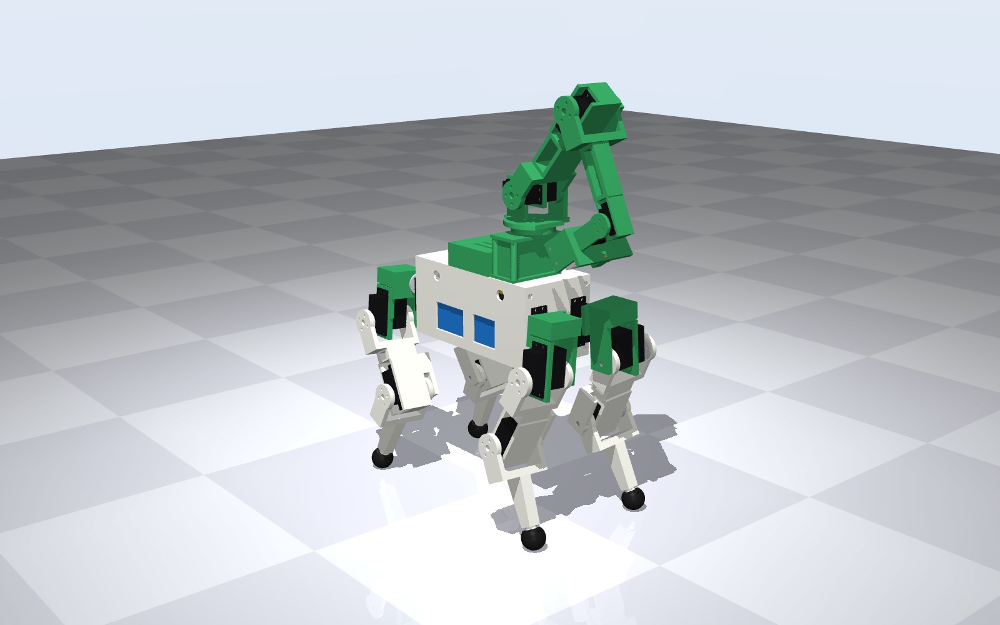
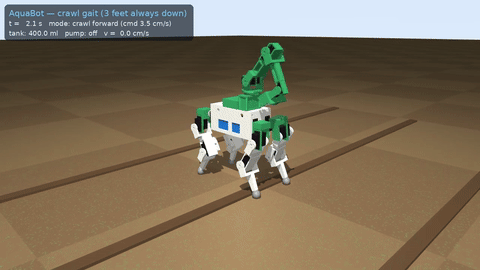
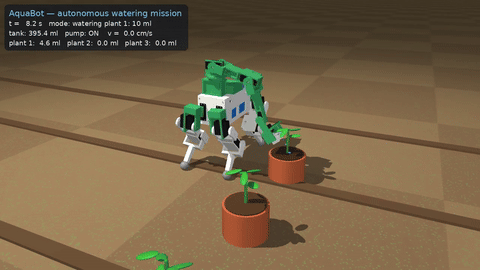
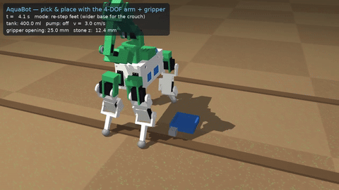
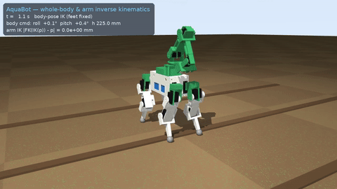
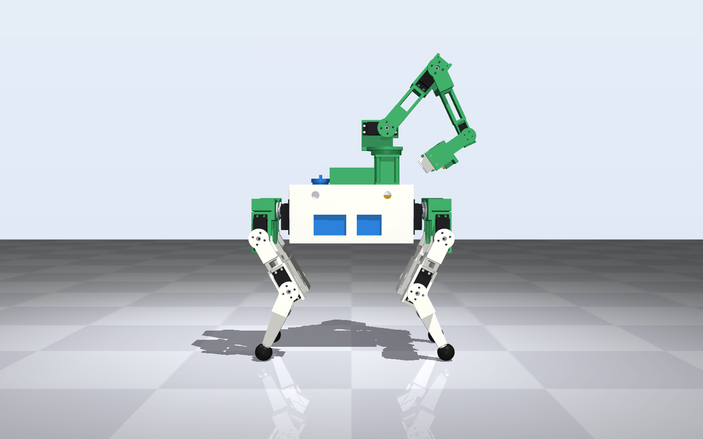
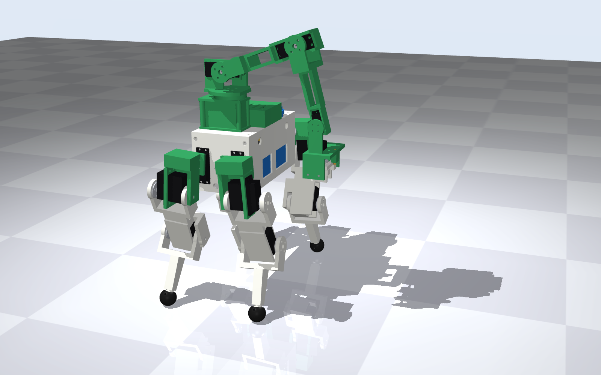
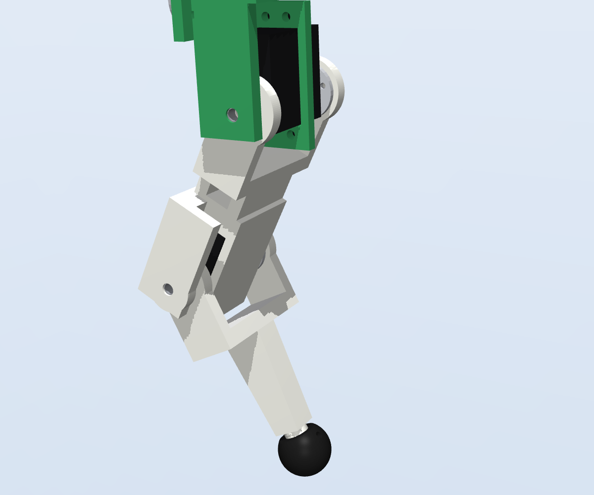
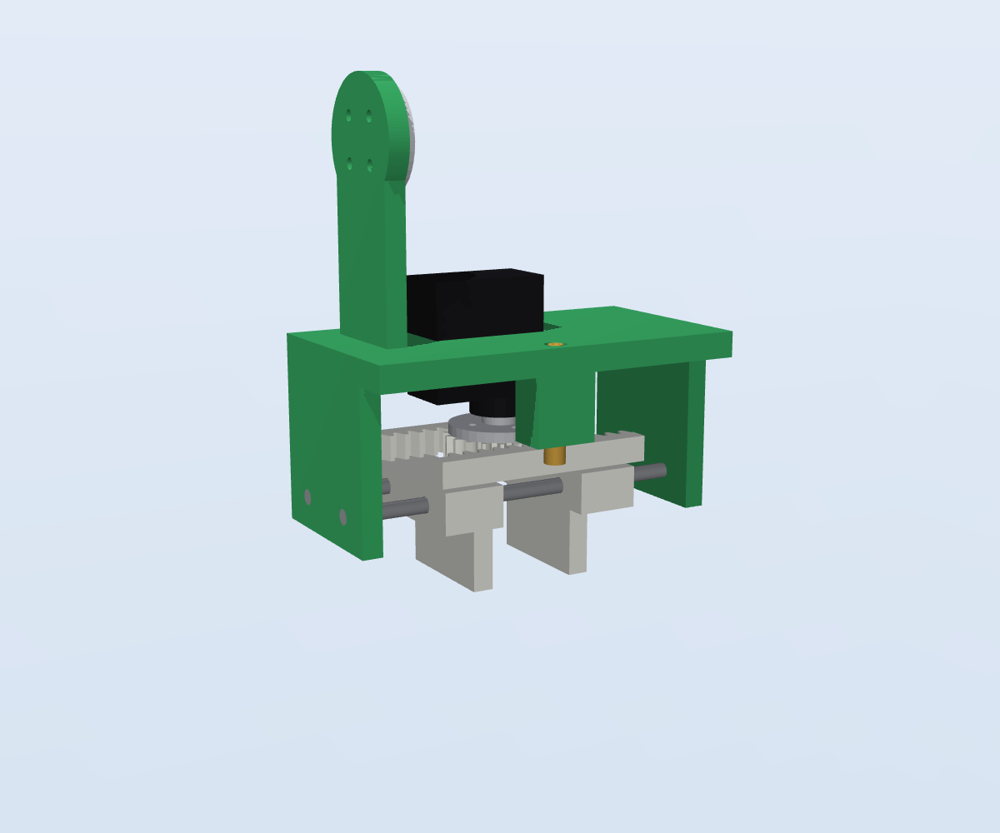

# AquaBot 🌱💧

**An open-source, 3D-printable 12-DOF quadruped that carries 400 ml of water and tends crops with a 4-DOF arm, a rack-and-pinion gripper and a ballistic-aimed watering nozzle.**

Everything in this repository — every printed part, the assemblies, the bill of materials, the MuJoCo and URDF models, the firmware configuration and the QA report — is generated from one parametric source, [`aquabot/params.py`](aquabot/params.py). Change a number, run `make all`, and the whole project (CAD → kinematics → simulation → BOM → firmware → QA) regenerates and re-verifies itself.



| Crawl gait | Watering mission | Pick & place | Whole-body IK |
|---|---|---|---|
|  |  |  |  |

Full-resolution simulation videos (MuJoCo, physics-based, 720p): [walk & turn](sim/videos/01_crawl_walk_turn.mp4) · [watering mission](sim/videos/02_watering_mission.mp4) · [pick & place](sim/videos/03_pick_and_place.mp4) · [IK showcase](sim/videos/04_ik_showcase.mp4) · [exploded assembly](sim/videos/05_exploded_assembly.mp4)

---

## Key numbers

<!-- METRICS -->
| | |
|---|---|
| Size (L × W × H, standing, arm stowed) | 347 × 202 × 470 mm |
| Mass (dry / 400 ml water) | 2.79 kg / 3.19 kg |
| Degrees of freedom | 12 legs + 4 arm + 1 gripper |
| Water | 404.5 ml tank (CAD cavity), 100 ml/min peristaltic pump |
| Walking (crawl, full tank) | 0.0272 m/s, max tilt 2.29° |
| Servo load in simulation | p99 0.489 × stall, 50 ms peak 0.826 × stall |
| Static torque safety factor | legs 2.76, arm 2.15 |
| Stability margin (worst mission pose) | 60.2 mm |
| Watering accuracy (sim) | 100 % of water lands in the pot |
| Estimated runtime (walking continuously) | 24.0 min per 2S 2200 mAh charge |
| Indicative cost | ≈ $397 |
| QA status | ✅ 292/292 checks passing ([report](qa/QA_REPORT.md)) |
<!-- /METRICS -->

## What's inside

| Area | Contents |
|---|---|
| **CAD** | 24 printed parts + 19 purchased-part envelopes, parametric [CadQuery](https://cadquery.readthedocs.io) source in [`aquabot/cad/`](aquabot/cad). Per-part [STEP](cad/step) and [STL](cad/stl), coloured assembly STEPs ([full robot](cad/assembly/aquabot_assembly.step), [leg](cad/assembly/leg_FL_assembly.step), [arm](cad/assembly/arm_assembly.step), [body](cad/assembly/body_assembly.step)), 4-view [drawing sheets](docs/drawings) |
| **BOM** | [BOM.md](bom/BOM.md) / [BOM.csv](bom/BOM.csv) — quantities derived from the CAD link tree, fastener counts derived from the CAD hole interfaces |
| **Kinematics** | Analytic leg IK, 4-DOF arm IK with tool offsets (TCP + nozzle), ballistic water aiming, whole-body pose IK, crawl & trot gait planners — [`aquabot/kinematics/`](aquabot/kinematics), derivation in [docs/kinematics.md](docs/kinematics.md) |
| **Simulation** | MuJoCo model generated from the CAD mass properties ([MJCF](sim/models/aquabot.xml)), realistic hobby-servo model (slew limit, PD, DC-motor torque/speed envelope, reflected rotor inertia), water-jet particles with mass bookkeeping, 5 scenario videos — [docs/simulation.md](docs/simulation.md) |
| **ROS** | [URDF](sim/models/urdf/aquabot.urdf) with meshes, inertias, limits and mimic joints (cross-checked against the link tree by QA) |
| **Firmware** | ESP32 + PCA9685 Arduino sketch with the IK and crawl planner ported to C++, generated `config.h` — [firmware/](firmware), [docs/firmware.md](docs/firmware.md) |
| **QA / QC** | Recursive, hierarchical verification of ~300 checks with an automatic control loop — [qa/QA_REPORT.md](qa/QA_REPORT.md), [docs/qa.md](docs/qa.md) |
| **Build docs** | [Assembly guide](docs/assembly_guide.md) · [Printing](docs/printing.md) · [Wiring](docs/wiring.md) · [Design calculations](docs/design_calcs.md) · [Requirements](docs/requirements.md) · [Design log](docs/design_log.md) |

## The robot

| | |
|---|---|
|  |  |
|  |  |

* **Legs (×4, 3 DOF):** DS3218MG servos. Hip abduction in the body, hip pitch in a shoulder bracket, knee servo housed in the femur. Every pitch joint is a **fork on the servo horn plus an idler on a 625 bearing**, so no servo output shaft carries the leg in pure cantilever. ANYmal-style "X" layout: front knees point back, rear knees point forward, which keeps both femurs clear of the body and balances hip/knee torque.
* **Arm (4 DOF):** yaw (on a 61806 thin-section bearing), shoulder and elbow on DS3218MG, wrist pitch on MG90S; 120 + 115 mm links, 75 mm to the TCP.
* **Gripper:** MG90S-driven pinion (m1, z20) between two racks, jaws on Ø3 mm steel guide rods, 1–41 mm opening, ≈ 21 N grip.
* **Water:** 400 ml printed PETG tank with an anti-slosh baffle (low in the body, under the battery), 100 ml/min peristaltic pump (self-priming, dry-run safe, dosing by time), silicone line along the arm to a Ø1.5 mm brass tip on the gripper. The controller solves the jet's ballistic trajectory so the water lands on the soil, not the leaves.
* **Electronics:** ESP32-DevKitC, PCA9685 (legs), ESP32 LEDC (arm), MPU-6050 IMU for attitude feedback, VL53L0X ToF, 2 × 6 V/10 A UBEC, 2S 2200 mAh LiPo with in-situ charge port.

## Quick start

```bash
pip install -r requirements.txt          # CadQuery, MuJoCo, trimesh, python-fcl, …
make all                                 # regenerate CAD, drawings, BOM, models, firmware config, renders
make videos                              # re-render the MuJoCo videos (EGL/OSMesa headless OK)
make qa                                  # recursive QA with control loop -> qa/QA_REPORT.md
make firmware-test                       # host-compile the sketch and check IK parity
```

Run a scenario interactively:

```python
from aquabot.sim import scenarios
print(scenarios.watering(video=False))      # metrics dict: delivered ml per plant, torques, tilt …
```

Flash the robot: open [`firmware/aquabot/aquabot.ino`](firmware/aquabot/aquabot.ino) in Arduino IDE 2.x (ESP32 core ≥ 3.0), select *ESP32 Dev Module*, upload, then follow the calibration steps in the [assembly guide](docs/assembly_guide.md#9-calibration).

## Repository layout

```
aquabot/            Python package — the single source of truth
  params.py         every dimension, rating, limit and requirement
  robot.py          link tree: kinematic frames + part placement (drives CAD, IK tests, MJCF, URDF, BOM)
  cad/              CadQuery part generators (body, legs, arm, gripper) + purchased-part envelopes
  kinematics/       leg / arm / body IK, crawl + trot gaits, ballistic aiming
  sim/              MJCF generator, servo + water runtime, scenarios
  qa/               recursive QA/QC engine and checks
  bom.py urdf.py massprops.py firmware_config.py render.py
cad/{step,stl,assembly}/   exported geometry          bom/   BOM.md, BOM.csv
sim/models/         aquabot.xml (MuJoCo), urdf/        sim/videos/   MP4s + metrics.json
firmware/           ESP32 sketch + host test harness   docs/  guides, drawings, images
qa/                 QA_REPORT.md, qa_report.json, qa_history.json
```

## Design status & honest limitations

AquaBot v1.0 is a **simulation-verified design**: geometry, fits, kinematics, statics and dynamics are checked by the QA suite, but no physical prototype has been built yet. Known limitations are tracked in the [design log](docs/design_log.md#known-limitations), most importantly:

* The default gait is a **statically stable crawl (~2.5 cm/s with a full tank)**. A trot is implemented but saturates DS3218 hip servos at this mass (the QA loop found this); faster gaits need ≥ 35 kg·cm servos.
* Purchased parts are modelled as datasheet envelopes — verify servo flange and horn patterns against your batch before printing.
* The printed tank must be sealed (food-safe epoxy) and leak-tested; an off-the-shelf 400 ml box can be substituted.

## License

MIT — see [LICENSE](LICENSE). Contributions welcome: open an issue with your QA report attached.
