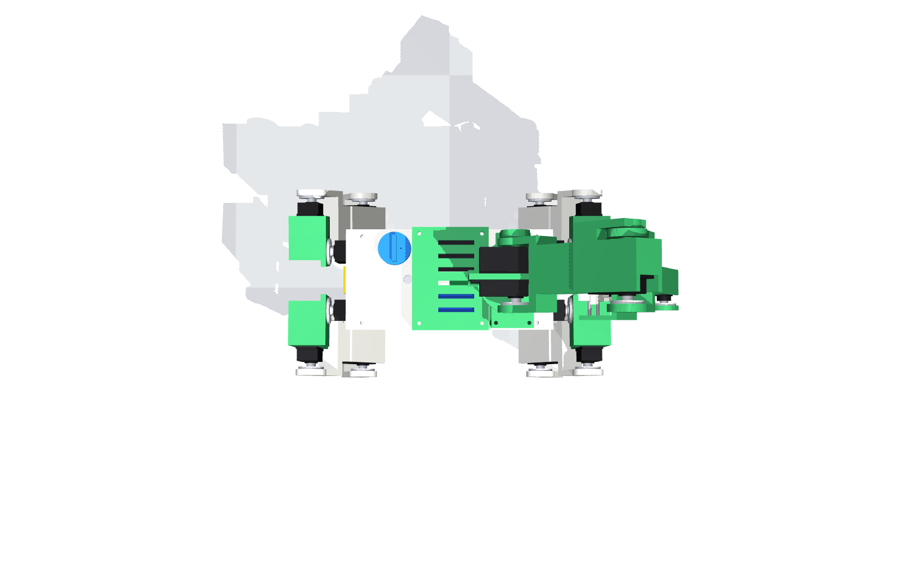

# Kinematics

All code lives in [`aquabot/kinematics/`](../aquabot/kinematics); the C++ port used by the robot is
[`firmware/aquabot/kinematics.cpp`](../firmware/aquabot/kinematics.cpp). Both are verified against the
CAD link tree ([`aquabot/robot.py`](../aquabot/robot.py)) by the QA suite (checks `S-KIN-01…04`, `S-FW-03`).

**Frames.** Body frame origin on the plane of the four hip-abduction axes, centred between them;
$+x$ forward, $+y$ left, $+z$ up. Units mm and rad. $e=\pm1$ front/rear, $s=\pm1$ left/right.

## 1. Leg (3 DOF)

| Joint | Axis | Location |
|---|---|---|
| J1 hip abduction $q_1$ | $+x$ | $H_1=(e\,X_1,\ s\,Y_1,\ 0)$, $X_1=116$, $Y_1=28$ |
| J2 hip pitch $q_2$ | $+y$ | $H_1 + R_x(q_1)\,(e\,d_x,\ s\,d_y,\ d_z)$, $(d_x,d_y,d_z)=(21,30,-45)$ |
| J3 knee $q_3$ | $+y$ | $J_2 + R_x(q_1)R_y(q_2)\,(0,0,-L_1)$, $L_1=90$ |
| foot centre | — | $J_3 + R_x(q_1)R_y(q_2+q_3)\,(0,0,-L_2)$, $L_2=100$ |

**Forward kinematics.** With the sagittal 2-link vector

$$x_s=-L_1\sin q_2-L_2\sin(q_2+q_3),\qquad z_s=-L_1\cos q_2-L_2\cos(q_2+q_3)$$

the foot is $p = H_1 + R_x(q_1)\,(e\,d_x+x_s,\ s\,d_y,\ d_z+z_s)^T$.

**Inverse kinematics.** Let $v=p-H_1$ and $a=s\,d_y$.

1. *Abduction.* $R_x$ preserves the $y$–$z$ norm, so the un-rolled vertical coordinate is
   $b=-\sqrt{v_y^2+v_z^2-a^2}$ (leg below the hip) and
   $$q_1=\operatorname{atan2}(v_z,v_y)-\operatorname{atan2}(b,a).$$
2. *Sagittal plane.* $u=-(v_x-e\,d_x)$, $w=-(b-d_z)$,
   $$D=\frac{u^2+w^2-L_1^2-L_2^2}{2L_1L_2},\qquad q_3=\kappa\arccos D,\qquad
     q_2=\operatorname{atan2}(u,w)-\operatorname{atan2}(L_2\sin q_3,\ L_1+L_2\cos q_3)$$
   with $\kappa=-1$ for front legs (knee points back) and $\kappa=+1$ for rear legs (knee points forward) — the
   ANYmal-style "X" layout chosen in [design-log iteration 3](design_log.md).

`|D| > 1` ⇒ out of reach. The real-time controller uses `clamp=True`, which returns the nearest straight-leg
solution instead of raising. QA verifies round-trip error $< 10^{-6}$ mm over 10 000 random poses and equality
with the CAD-tree FK.

**Static torques.** $\tau = J^T F$ with the foot Jacobian $J=\partial p/\partial q$ (central differences on the
analytic FK) — used for the torque budget (`S-TRQ-01`).

## 2. Arm (yaw + 3 pitch) with tool offsets

After the yaw $q_y$ (axis $+z$ through the shoulder at $S=(55,0,128)$) the arm is planar. Absolute link
angles measured up from horizontal: $\varphi_1=q_s$, $\varphi_2=\varphi_1+q_e$, $\varphi_3=\varphi_2+q_w$.
A tool point at $(a,b)$ in the wrist frame ($a$ along the gripper, $b$ "above" it) is

$$r=L_1\cos\varphi_1+L_2\cos\varphi_2+a\cos\varphi_3-b\sin\varphi_3,\qquad
  z=L_1\sin\varphi_1+L_2\sin\varphi_2+a\sin\varphi_3+b\cos\varphi_3$$

and $p=S+(r\cos q_y,\ r\sin q_y,\ z)$. Tools: TCP $(75,0)$, nozzle tip $(58,20)$.

**IK** for a point $p$ and tool pitch $\varphi_3$ (outward-referenced, + up):
$q_y=\operatorname{atan2}(p_y-S_y,\ p_x-S_x)$, $r=\lVert p_{xy}-S_{xy}\rVert$, $z=p_z-S_z$, wrist point
$w_r=r-a\cos\varphi_3+b\sin\varphi_3$, $w_z=z-a\sin\varphi_3-b\cos\varphi_3$, then the 2-link solution
$q_e=\mp\arccos D$ (elbow-up uses $-$), $q_s=\operatorname{atan2}(w_z,w_r)-\operatorname{atan2}(L_2\sin q_e, L_1+L_2\cos q_e)$,
$q_w=\varphi_3-q_s-q_e$. The second yaw branch ($q_y+\pi$, $r\to-r$, $\varphi\to\pi-\varphi$) is also
returned by `ik_all()`; `ik()` picks the in-limit branch closest to a reference pose.

## 3. Ballistic water aiming

Jet speed from pump flow and orifice: $v_0=Q/A=\dfrac{100\ \text{ml/min}}{\pi(0.75\ \text{mm})^2}\approx0.94$ m/s.
For a nozzle pitch $\theta$ (−50°) and a drop height $h$ (55 mm) above the soil, the flight time is
$t=\big(v_z+\sqrt{v_z^2+2gh}\big)/g$ with $v_z=v_0\sin\theta$, so the nozzle tip must sit
$d=v_0\cos\theta\,t$ (≈ 34 mm) back from the target, towards the robot. `aim_nozzle()` returns that tip
position; the arm IK with the nozzle tool places it. The simulation integrates every droplet ballistically
and counts where it lands (QA `S-SIM-06`: ≥ 85 % in the pot; achieved 100 %).

## 4. Whole-body IK

For a commanded body pose $(x,y,z,\phi,\theta,\psi)$ and fixed world foot positions $p^w_i$:
$p^b_i = R(\phi,\theta,\psi)^T(p^w_i-x_b)$, then per-leg IK. The IMU attitude loop applies the same rotation
with a PI correction on roll/pitch.

## 5. Gaits

**Crawl (default).** Swing order RL → FL → RR → FR, each leg airborne for 10.8 % of a 2.4 s cycle. Before
every lift-off the body sways so the CoG sits ≥ 20 mm inside the support triangle. The required shift is
computed from the *planned, moving* stance feet over the whole swing window (not the neutral feet — the
difference made the robot fall in iteration 5). Sway transitions happen only while four feet are down and
use minimum-jerk profiles so the ZMP stays inside the 4-foot polygon. Turning in place uses a slower 3.0 s
cycle: at 1.9–2.35 s a diagonal rocking mode builds up and tips the robot (design-log iteration 10).

**Trot.** Diagonal pairs with min-jerk swing and $64s^3(1-s)^3$ lift profile. Implemented and simulated, but
it saturates DS3218 hip servos at 3.2 kg (see design log) — kept for lighter configurations.
