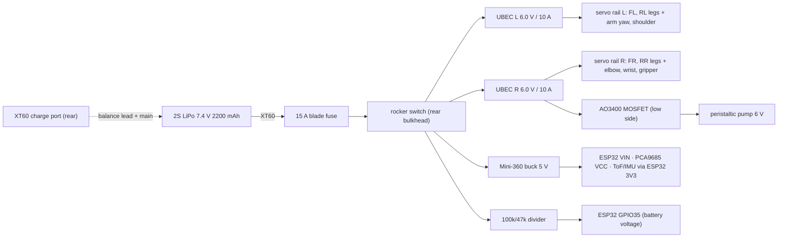

# Wiring

Pin assignments are generated into [`firmware/aquabot/config.h`](../firmware/aquabot/config.h) by
[`aquabot/firmware_config.py`](../aquabot/firmware_config.py); change them there, not in the header.

## Power tree

All grounds are common. Put a 1000 µF / 16 V capacitor across each servo rail at the PCA9685 V+ terminal.
The PCA9685 **V+ terminal is fed from the UBEC rails**, never from the 5 V logic supply.

## Signals

| Function | Device | Pin / channel |
|---|---|---|
| I²C SDA / SCL (PCA9685 0x40, MPU-6050 0x68, VL53L0X 0x29) | ESP32 | GPIO 21 / GPIO 22 |
| FL hip-abd / hip-pitch / knee | PCA9685 | ch 0 / 1 / 2 |
| FR hip-abd / hip-pitch / knee | PCA9685 | ch 4 / 5 / 6 |
| RL hip-abd / hip-pitch / knee | PCA9685 | ch 8 / 9 / 10 |
| RR hip-abd / hip-pitch / knee | PCA9685 | ch 12 / 13 / 14 |
| Arm yaw / shoulder / elbow | ESP32 LEDC | GPIO 25 / 26 / 27 |
| Wrist / gripper (MG90S) | ESP32 LEDC | GPIO 32 / 33 |
| Pump MOSFET gate | ESP32 LEDC 2 kHz | GPIO 13 |
| Battery sense | ESP32 ADC1 | GPIO 35 |
| ToF XSHUT | ESP32 | GPIO 4 |
| Status LED | ESP32 | GPIO 2 |

Servo leads: J1 servos sit inside the body; J2/J3 leads run down the outside of the bracket and enter the tub
through the Ø12 mm side holes and bulkhead grommets (25 cm extensions). The arm leads run inside the pedestal
and out through its slot; leave a service loop for ±120° yaw.

## Current budget

| Load | Typical | Peak |
|---|---|---|
| 17 servos, crawl gait (simulated, I ∝ torque incl. holding) | 4.7 A mean | 9.1 A |
| arm alone, reaching with payload | 0.5–1 A | 2.5 A |
| ESP32 + sensors | 0.2 A @ 5 V | 0.35 A |
| Pump | 0.35 A @ 6 V | 0.4 A |

Two 10 A UBECs give ≈ 2× headroom over the simulated peak (QA `S-PWR-02`). Use 16 AWG from the battery to
the UBECs and 20 AWG from the UBECs to the PCA9685 V+ terminals.
